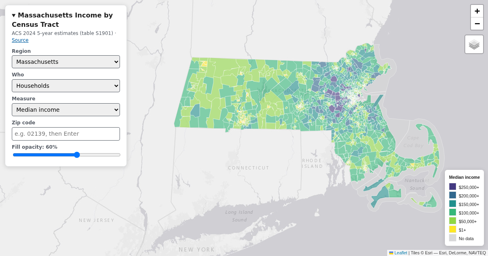

# Income by Census Tract

An interactive map of household and family income by census tract for Massachusetts and Los Angeles (Los Angeles and Orange counties), built from the Census Bureau's 2024 American Community Survey.

[Live map](https://winstonhoyle.github.io/massachusetts-income-tracts/) · [Massachusetts](https://winstonhoyle.github.io/massachusetts-income-tracts/?region=massachusetts) · [Los Angeles](https://winstonhoyle.github.io/massachusetts-income-tracts/?region=los-angeles)



## What it does

The map colors about 4,700 census tracts by median income, mean income, total count, or the share of households in each of 10 income brackets. You can switch between households, families, married-couple families, and nonfamily households. Click a tract to see its value, or search a zip code to outline it. On a phone, the control panel starts collapsed so the map has room.

## How it works

| Part | What | File |
| --- | --- | --- |
| Data pipeline | A Python script using GeoPandas. It pulls ACS 5-year table S1901 from the Census API, joins it to TIGER/Line tract shapes, simplifies the geometry to about 5 m, and writes one GeoJSON file per region | [`format_data.py`](format_data.py) |
| Map | A single static HTML page using Leaflet's canvas renderer, with no build step | [`app/index.html`](app/index.html) |
| Hosting | GitHub Actions runs the tests, then deploys `app/` to GitHub Pages | [`.github/workflows/pages.yml`](.github/workflows/pages.yml) |

Simplifying the shapes and rounding coordinates cut the Massachusetts data from 27 MB to 7.5 MB. The tract file is about 1 MB gzipped. Zip code outlines come from the 2020 ZIP Code Tabulation Areas and load in the background.

## Data
* [ACS 2024 5-year, S1901: Income in the Past 12 Months](https://api.census.gov/data/2024/acs/acs5/subject/groups/S1901.html)
* [2024 TIGER/Line Census Tracts](https://www.census.gov/geographies/mapping-files/time-series/geo/tiger-line-file.html)
* [2020 ZIP Code Tabulation Areas](https://www.census.gov/geographies/mapping-files/time-series/geo/cartographic-boundary.2020.html)

## Running it

You need Python 3.12 or later and a free [Census API key](https://api.census.gov/data/key_signup.html). Dependencies are listed in [`pyproject.toml`](pyproject.toml), and `make` creates `.venv` and installs them.

```
cp .env.sample .env   # paste your key into .env
make data             # rebuild app/<region>.json and app/<region>-zipcodes.json
make serve            # http://localhost:8000
make test             # pytest
```

To add a region, add its state and county FIPS codes to `REGIONS` in `format_data.py` and its name to `REGIONS` in `app/index.html`, then run `make data`.
